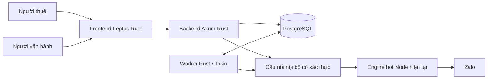

# Cổng thuê MYBOT — frontend và backend bằng Rust

## 1. Ý tưởng sản phẩm và quy tắc thuê

Xây một **cổng khách hàng**, nơi người thuê đăng nhập, nạp ví, mua suất chạy bot, liên kết tài khoản Zalo và tự quản lý hoạt động của mình.

Tên giao diện đề xuất: **MYBOT Cloud**.

### Các lựa chọn đã chốt

| Nội dung | Thiết kế |
|---|---|
| Công nghệ web | Frontend Rust bằng Leptos; backend Rust bằng Axum |
| Tài khoản khách | Bạn tạo tài khoản cho từng khách |
| Thanh toán | Khách nạp ví; bạn kiểm tra chuyển khoản và duyệt thủ công |
| Cách thuê | Mỗi suất có thời hạn riêng; một suất chạy một tài khoản Zalo tại một thời điểm |
| Bắt đầu tính hạn | Khi bot kết nối Zalo thành công lần đầu |
| Suất chưa kích hoạt | Sau 7 ngày tự hủy và hoàn tiền mua suất về ví |
| Đổi tài khoản Zalo | Giữ nguyên hạn thuê còn lại |
| Quy mô ban đầu | Tối đa 30 suất; số bot thực tế được chạy còn chịu giới hạn tài nguyên VPS |

**Ví dụ:** Khách mua 3 suất × 30 ngày. Khách có thể kết nối ba tài khoản Zalo vào ba thời điểm khác nhau, nên ngày hết hạn có thể khác nhau. Suất số 1 còn 12 ngày thì đổi từ tài khoản A sang B vẫn còn đúng thời gian đó.

### Quy tắc nghiệp vụ mặc định

- **Giá thuê:** `số suất × số ngày × đơn giá/bot/ngày`. Bạn cấu hình đơn giá trước khi mở bán; giá mới áp dụng cho đơn mới.
- Cho phép chọn **1–365 ngày**, số lượng trong phạm vi suất còn bán được.
- Thời gian được lưu bằng ngày hết hạn chính xác. Giao diện hiển thị “12 ngày 5 giờ”, không chạy tác vụ trừ một ngày vào mỗi nửa đêm.
- Sau lần kích hoạt đầu tiên, thời gian tiếp tục trôi khi khách dừng bot, mất kết nối hoặc đổi tài khoản.
- Gia hạn suất đang hoạt động: cộng ngày vào hạn hiện tại. Gia hạn suất đã hết hạn: tính từ thời điểm gia hạn thành công.
- Suất chưa kích hoạt chưa cho gia hạn; khách chọn đủ số ngày ngay khi mua.
- Gia hạn thủ công, hỗ trợ chọn nhiều suất cùng lúc. Bản đầu chưa tự động trừ ví để gia hạn.
- **“Gỡ/xóa bot”** sẽ dừng bot, hủy các công việc gắn với tài khoản và xóa phiên đăng nhập. Suất thuê cùng thời gian còn lại vẫn được giữ để kết nối tài khoản khác.
- Hết hạn: dừng bot và quảng cáo. Giữ cấu hình tối đa 30 ngày để khách gia hạn; lịch sử ví và đơn hàng được lưu riêng.
- Sau khi kích hoạt, thao tác dừng hoặc gỡ bot không tự hoàn tiền. Bạn có chức năng bù ngày hoặc hoàn ví có ghi lịch sử để xử lý sự cố.

Khách phải thấy rõ các quy tắc về kích hoạt, đổi tài khoản, gỡ bot và hoàn tiền trước khi xác nhận mua.

## 2. Frontend Rust: giao diện dành cho người thuê

### Công nghệ và hướng thiết kế

Dùng **Leptos SSR kết hợp hydration**: giao diện được viết bằng Rust; trình duyệt nhận HTML, CSS và WebAssembly. Axum là một tích hợp chính thức của Leptos. [Tài liệu Leptos](https://book.leptos.dev/ssr/index.html)

Giao diện ưu tiên điện thoại, tiếng Việt, nền sáng, màu chủ đạo xanh dương, trạng thái dễ đọc. Desktop dùng thanh điều hướng bên trái; điện thoại dùng thanh điều hướng gọn và menu bổ sung.

Các nút chính luôn rõ nghĩa: **Thuê thêm — Kết nối Zalo — Gia hạn — Tạo quảng cáo**.

### Các trang chính

| Trang | Nội dung và thao tác |
|---|---|
| **Giới thiệu / Bảng giá** | Cách thuê, công cụ tính tiền theo số ngày và số bot, hướng dẫn liên hệ để được cấp tài khoản |
| **Đăng nhập / Kích hoạt tài khoản** | Đăng nhập, đặt mật khẩu lần đầu qua liên kết được cấp, hướng dẫn yêu cầu đặt lại mật khẩu |
| **Tổng quan** | Số dư ví, suất đang dùng, suất chưa kết nối, bot sắp hết hạn, chiến dịch đang chạy và lỗi cần xử lý |
| **Bot của tôi** | Danh sách suất, tài khoản Zalo đang kết nối, thời gian còn lại và các thao tác quản lý |
| **Thuê thêm / Gia hạn** | Chọn số ngày, số lượng hoặc các suất cần gia hạn; xem báo giá và số dư sau thanh toán |
| **Ví và nạp tiền** | Số dư, thông tin chuyển khoản, yêu cầu nạp, trạng thái duyệt và lịch sử cộng/trừ |
| **Quảng cáo** | Danh sách chiến dịch, tạo mới, đặt lịch, tạm dừng, tiếp tục, dừng và xem báo cáo |
| **Thông báo** | Nạp tiền được duyệt, sắp hết hạn, phiên Zalo hết hiệu lực, chiến dịch bị dừng |
| **Tài khoản / Hỗ trợ** | Đổi mật khẩu, đăng xuất thiết bị, hướng dẫn và kênh hỗ trợ |

### Trang “Bot của tôi”

Mỗi suất hiển thị thành một thẻ:

- Tên khách tự đặt, ví dụ **Bot bán hàng số 1**.
- Ảnh và tên tài khoản Zalo đang kết nối.
- Trạng thái: chưa kết nối, chờ quét QR, đang kết nối, hoạt động, tạm dừng, cần đăng nhập lại hoặc hết hạn.
- Thời gian còn lại và ngày hết hạn.
- Số nhóm đã đồng bộ, thời điểm cập nhật gần nhất.
- Các nút: **Quản lý — Chạy/Dừng — Đổi Zalo — Gia hạn — Gỡ bot**.

Hỗ trợ tìm kiếm, lọc trạng thái, chọn nhiều suất để gia hạn hoặc dừng bot.

Trạng thái “Hoạt động” phải dựa vào phiên Zalo và listener của bot; trạng thái tiến trình chạy trên VPS được dùng làm dữ liệu hỗ trợ.

### Trang chi tiết một bot

| Tab | Chức năng |
|---|---|
| **Tổng quan** | Tài khoản kết nối, hạn thuê, trạng thái, lịch sử kết nối và các lỗi gần nhất |
| **Cấu hình** | Prefix, tên hiển thị trong web và các tùy chọn vận hành được phép chỉnh riêng cho bot |
| **Lệnh** | Tìm lệnh, bật/tắt, quyền sử dụng trong bot, cooldown, mẫu phản hồi và các trường Command Studio được cấp quyền |
| **Nhóm** | Đồng bộ nhóm, tìm kiếm, xem thông tin và điều chỉnh cấu hình từng nhóm |
| **Tự động hóa** | Chào thành viên, phản hồi tự động, chống spam/link/từ khóa và các chức năng engine hiện hỗ trợ theo từng bot |
| **Quảng cáo** | Chiến dịch thuộc bot này và báo cáo gửi |
| **Nhật ký** | Lịch sử thao tác, thay đổi cấu hình, kết nối và lỗi đã được che thông tin nhạy cảm |

Các chức năng phụ thuộc quyền quản trị nhóm sẽ hiển thị điều kiện cần đáp ứng và lý do khi không thể dùng.

Phần quản lý lệnh dựa trên contract hiện có, bổ sung thuộc tính xác định trường nào người thuê được sửa. Khách được quản lý cấu hình thuộc bot/nhóm của mình; các quyền điều hành nền tảng vẫn do hệ thống kiểm soát.

### Luồng thuê và kết nối

1. Khách chọn số suất và số ngày.
2. Web lấy báo giá từ server.
3. Khách xác nhận dùng số dư ví.
4. Hệ thống tạo các suất “Chờ kết nối”, hiển thị hạn kích hoạt 7 ngày.
5. Khách mở một suất và bấm **Kết nối Zalo**.
6. Web hiển thị QR cùng trạng thái quét và xác nhận.
7. Khi Zalo đăng nhập, xác minh đúng UID và listener sẵn sàng, server bắt đầu thời hạn thuê.
8. Web chuyển sang trang quản lý bot.

Nếu kết nối thất bại trước bước kích hoạt thành công, suất vẫn chưa bị tính thời gian.

### Luồng nạp ví

1. Khách nhập số tiền muốn nạp.
2. Web tạo mã yêu cầu riêng và hiển thị ngân hàng, số tài khoản, nội dung chuyển khoản; QR ngân hàng do bạn cấu hình.
3. Khách chuyển khoản rồi bấm **Tôi đã chuyển**, có thể đính kèm ảnh.
4. Yêu cầu chuyển sang “Chờ kiểm tra”.
5. Bạn đối chiếu ngân hàng và duyệt số tiền thực nhận.
6. Ví được cộng tiền, khách nhận thông báo trong web.

Giao diện không tự công nhận đã thanh toán dựa vào ảnh chuyển khoản.

### Khu vực vận hành cho bạn

Bổ sung một khu vực nhỏ **`/operator`**, cũng viết bằng Rust, gồm:

- Tạo, khóa tài khoản và cấp liên kết đặt lại mật khẩu.
- Duyệt hoặc từ chối yêu cầu nạp.
- Cấu hình giá thuê và số suất được bán.
- Xem đơn thuê, bù ngày, hoàn ví và lịch sử thao tác.

Dashboard hiện tại tiếp tục phục vụ quản trị hạ tầng bot. Cổng người thuê có giao diện và quyền truy cập riêng.

## 3. Backend Rust: kiến trúc, dữ liệu và API

### Kiến trúc đề xuất

**Toàn bộ web mới, nghiệp vụ thuê, ví và worker quảng cáo dùng Rust.** Engine Zalo Node hiện tại tiếp tục xử lý các chức năng bot thông qua cầu nối.

Mã nguồn đã có mô hình Rust gọi Node qua loopback với chữ ký HMAC, thể hiện trong [bridge_client.rs](C:/Users/AD/.codex/worktrees/vps-incremental-update/HHH_MYBOT-V3MYBOTQRLOGIN-main/rust/crates/mybot-dashboard/src/bridge_client.rs:1). Thiết kế mới tái sử dụng mô hình này và bổ sung kiểm tra quyền sở hữu suất.

Chia phần Rust mới thành ba đơn vị:

- **Portal:** Axum, giao diện Leptos, API khách hàng và khu vực vận hành.
- **Domain:** kiểu dữ liệu, quy tắc ví, thuê, quyền truy cập và hợp đồng API dùng chung.
- **Worker:** lịch gửi, quét thành viên, xử lý hàng đợi, hết hạn và đồng bộ runtime.

Dùng PostgreSQL qua SQLx cho dữ liệu web. Worker nhận việc bằng khóa hàng và `SKIP LOCKED`, phù hợp với hàng đợi có nhiều bộ xử lý. Bản đầu dùng PostgreSQL làm hàng đợi bền vững để giảm số dịch vụ phải vận hành. [Tài liệu PostgreSQL](https://www.postgresql.org/docs/18/sql-select.html)

### Các nhóm dữ liệu chính

| Nhóm | Dữ liệu |
|---|---|
| **Tài khoản** | Khách hàng, người vận hành, phiên đăng nhập, token kích hoạt/đặt lại mật khẩu |
| **Ví** | Ví, bút toán cộng/trừ, yêu cầu nạp và tham chiếu giao dịch ngân hàng |
| **Thuê** | Báo giá, đơn hàng, các suất thuê, ngày kích hoạt, ngày hết hạn |
| **Kết nối bot** | Liên kết suất–UID Zalo–runtime, phiên QR, revision và thao tác đang xử lý |
| **Quảng cáo** | Chiến dịch, phiên bản nội dung, lịch, lượt chạy, người nhận và kết quả từng lần gửi |
| **Vận hành** | Thông báo, nhật ký kiểm toán, hàng đợi công việc và outbox đồng bộ |

**`slot_id` là định danh cố định của suất thuê, độc lập với UID Zalo.**

Một liên kết tài khoản có `binding_revision`. Khi đổi Zalo, revision tăng; công việc cũ mang revision trước sẽ bị từ chối.

Cấu hình runtime tiếp tục được áp dụng qua các adapter hiện có vào dữ liệu riêng của bot. PostgreSQL lưu nghiệp vụ web và lịch sử yêu cầu áp dụng; cổng khách hàng không ghi thẳng vào các file cấu hình toàn hệ thống.

### Tài khoản và phân quyền

- Bạn tạo username cho khách; hệ thống sinh liên kết đặt mật khẩu một lần, hết hạn sau 24 giờ.
- Không mở đăng ký công khai trong bản đầu.
- Khôi phục mật khẩu qua liên kết một lần do bạn cấp; sau khi đặt lại sẽ thu hồi các phiên đăng nhập cũ.
- Mật khẩu băm bằng Argon2id.
- Phiên đăng nhập lưu phía server; cookie `HttpOnly`, `Secure`, có bảo vệ CSRF.
- Khu vực vận hành dùng quyền riêng và xác thực hai bước.
- Mọi truy vấn, file, luồng sự kiện và công việc nền đều kiểm tra chủ sở hữu.

Tenant được lấy từ danh tính đã xác thực phía server. Bổ sung PostgreSQL RLS cho các bảng thuộc khách hàng; tài khoản database của API không có quyền bỏ qua RLS. Các lớp bảo vệ này cũng phải áp dụng cho cache, tệp và worker. [OWASP về ứng dụng nhiều khách hàng](https://cheatsheetseries.owasp.org/cheatsheets/Multi_Tenant_Security_Cheat_Sheet.html), [PostgreSQL RLS](https://www.postgresql.org/docs/current/ddl-rowsecurity.html)

### Ví và đơn hàng

- Tiền dùng số nguyên VND, không dùng số thực.
- Lịch sử ví là các bút toán bất biến; điều chỉnh tạo bút toán mới.
- Duyệt nạp yêu cầu mã giao dịch ngân hàng và số tiền thực nhận. Một mã giao dịch chỉ được ghi nhận một lần.
- Báo giá do server tạo, có hiệu lực 10 phút và chỉ được sử dụng một lần.
- Mua/gia hạn phải khóa ví và kiểm tra số dư trong cùng transaction.
- Mua nhiều suất thành công toàn bộ hoặc không trừ tiền.
- Kiểm tra số suất còn bán được trước khi nhận đơn; suất chờ kích hoạt cũng giữ chỗ.
- Suất hết hạn muốn gia hạn phải giữ lại được tài nguyên trước khi trừ ví.
- Mọi yêu cầu ghi tiền dùng `Idempotency-Key` để chống trừ/cộng hai lần khi bấm lại hoặc mất mạng.

Việc hủy suất sau 7 ngày và việc kích hoạt suất phải tranh chấp trên cùng một khóa dữ liệu: chỉ một kết quả được chấp nhận. Nếu đã hoàn tiền, phiên QR đang chờ phải bị hủy.

### Quản lý runtime và đổi Zalo

Luồng đổi tài khoản:

1. Kiểm tra chủ sở hữu và hạn thuê.
2. Tạo phiên QR thay thế có thời hạn; các công việc gửi của suất được tạm dừng.
3. Xác minh UID mới, kiểm tra tài khoản có đang được sử dụng ở suất khác hay thuộc bot quản trị không.
4. Dừng runtime cũ trước khi cho runtime mới hoạt động.
5. Chuyển liên kết, tăng revision và giữ nguyên `expires_at`.
6. Xóa phiên cũ, đồng bộ nhóm của tài khoản mới.
7. Đánh dấu chiến dịch cũ cần xem lại đối tượng nhận trước khi được chạy tiếp.

Prefix và cấu hình lệnh có thể giữ theo suất. Nhóm, danh sách thành viên và chiến dịch gắn với tài khoản cũ phải được đối chiếu lại.

Nếu UID từng thuộc khách khác, hệ thống phải tạo dữ liệu sạch cho liên kết mới; không nạp lại cookie, nhật ký hoặc cấu hình riêng của người thuê trước.

Kiểm tra hạn thuê được thực hiện tại **API, worker và engine bot**. Những đường quản lý cũ qua lệnh Zalo cũng phải nhận biết suất do portal quản lý, tránh cấp thêm ngày hoặc kích hoạt ngoài nghiệp vụ ví.

### Các API chính

Tiền tố API khách hàng: **`/api/customer/v1`**.

| Nhóm | Endpoint chính |
|---|---|
| **Đăng nhập** | `POST /auth/activate`, `/auth/login`, `/auth/logout`; `GET /me`; quản lý mật khẩu và phiên |
| **Ví** | `GET /wallet`, `/wallet/entries`; `POST /wallet/topups`; xem trạng thái từng yêu cầu |
| **Thuê** | `POST /rental-quotes` cho mua mới hoặc gia hạn; `POST /orders` xác nhận báo giá; `GET /slots` |
| **Kết nối Zalo** | `POST /slots/{id}/connections`; xem QR/trạng thái; `DELETE /slots/{id}/connection` |
| **Vận hành bot** | `POST /slots/{id}/actions` với danh sách thao tác cho phép |
| **Cấu hình** | Đọc/cập nhật cấu hình bot, nhóm và contract lệnh thuộc suất |
| **Thành viên** | Tạo tác vụ quét thành viên theo bot và nhóm; lấy kết quả quét |
| **Quảng cáo** | Tạo/sửa chiến dịch, preview, bắt đầu, tạm dừng, tiếp tục, dừng và xem kết quả |
| **Tệp / Sự kiện** | Upload theo quyền sở hữu; `GET /events` dùng SSE |
| **Tác vụ** | `GET /operations/{id}` theo dõi thao tác bất đồng bộ |

API người vận hành nằm riêng tại **`/api/operator/v1`**.

Các kiểu dữ liệu dùng chung cần định nghĩa rõ gồm `RentalSlot`, `AccountBinding`, `Operation`, `Campaign`, `CampaignRun`, `Delivery` và `RosterResult`.

Quy ước giao tiếp:

- Việc kéo dài trả `202 + operation_id`; giao diện theo dõi đến khi có kết quả cuối.
- Chỉnh cấu hình có revision; dữ liệu cũ trả `409 REVISION_CONFLICT`.
- Lỗi có mã ổn định như `INSUFFICIENT_BALANCE`, `SLOT_EXPIRED`, `CAPACITY_EXCEEDED`, `ACCOUNT_ALREADY_BOUND`.
- Trình duyệt gửi mã tệp và mã tài nguyên; đường dẫn máy chủ, cổng runtime và URL nội bộ do server quyết định.

## 4. Quảng cáo: chức năng và cách xử lý

Mỗi chiến dịch thuộc **một suất và một tài khoản Zalo cụ thể**. Khách có thể sao chép chiến dịch sang bot khác, sau đó chọn lại nhóm.

### Chế độ A — Gửi vào nhóm

Khách chọn:

- Một hoặc nhiều nhóm của bot.
- Nội dung văn bản, liên kết và ảnh đính kèm.
- Gửi ngay, gửi vào thời điểm đã chọn hoặc gửi lặp.
- Khoảng cách giữa các tin, trong giới hạn hệ thống.

Lịch lặp hỗ trợ:

- Mỗi N phút hoặc N giờ.
- Hằng ngày vào các giờ chọn.
- Theo ngày trong tuần.
- Kết thúc vào ngày chọn, sau số lượt chọn hoặc khi người dùng dừng.

Mọi lịch đều bị giới hạn bởi hạn thuê. Múi giờ mặc định là `Asia/Ho_Chi_Minh`.

### Chế độ B — Gửi riêng cho thành viên nhóm

Luồng giao diện:

1. Chọn bot và các nhóm nguồn.
2. Bấm **Quét thành viên**.
3. Xem số thành viên lấy được, trạng thái đầy đủ/một phần/chưa xác định và thời điểm quét.
4. Xem danh sách người nhận, bỏ chọn hoặc thêm vào danh sách loại trừ.
5. Nhập nội dung, xem trước và gửi thử tới một người do khách chọn.
6. Xác nhận gửi hoặc đặt lịch.
7. Theo dõi kết quả từng người nhận.

Tách phần lấy dữ liệu của `getuser` thành dịch vụ roster dùng chung cho lệnh chat và web. Giữ nguyên cách phản hồi hiện tại của lệnh chat.

Nguồn hiện có đã dùng `getgi/v2` để bổ sung thành viên và có xử lý danh sách chưa đầy đủ trong [get-user.js](C:/Users/AD/.codex/worktrees/vps-incremental-update/HHH_MYBOT-V3MYBOTQRLOGIN-main/src/service-debug/info-service/get-user.js:78). Vì vậy, web hỗ trợ lấy thành viên của các nhóm ẩn mà API trả được, đồng thời phải báo đúng mức độ đầy đủ. Lấy được UID cũng chưa đảm bảo Zalo cho phép gửi tin riêng đến UID đó.

### Quy tắc người nhận và lịch lặp

- Một người xuất hiện trong nhiều nhóm được gửi tối đa một lần trong cùng lượt chạy.
- Mỗi lượt có danh sách người nhận cố định để theo dõi chính xác.
- Chiến dịch DM mặc định dùng danh sách khách đã duyệt. Có tùy chọn rõ ràng **“Quét lại thành viên trước mỗi lượt”**.
- Nếu quét chỉ được một phần, khách phải chấp nhận gửi tới phần đã lấy được. Web không ghi “toàn bộ thành viên” khi chưa xác nhận đủ.
- Danh sách loại trừ áp dụng cho mọi lượt tiếp theo.
- Đổi Zalo làm mất hiệu lực đối tượng nhận của chiến dịch cũ; khách phải chọn lại.
- Lượt trước chưa kết thúc thì bỏ qua lịch bị chồng, ghi rõ lý do.
- Sau downtime, bỏ qua các mốc đã lỡ; không gửi dồn.
- Gia hạn xong không tự khởi chạy lại quảng cáo đã dừng vì hết hạn.

### Worker gửi tin

- Lịch và tiến độ lưu trong PostgreSQL, tồn tại qua restart.
- Dùng khóa duy nhất theo lượt chạy và người nhận để chống tạo công việc trùng.
- Mỗi bot chỉ có một luồng gửi quảng cáo tại một thời điểm; đi qua outbound limiter của engine để giữ khả năng phản hồi lệnh.
- Mặc định tối thiểu 5 giây giữa các tin nhóm và 10 giây giữa các DM. Đây là giới hạn vận hành ban đầu, có thể tăng theo cấu hình hệ thống.
- Kiểm tra lại hạn thuê, revision tài khoản, quyền truy cập nhóm và trạng thái chiến dịch trước mỗi lần gửi.
- Lỗi quyền, bị chặn hoặc không thể gửi cho người lạ được ghi nhận và bỏ qua.
- Khi bị giới hạn tốc độ, tạm dừng và áp dụng thời gian chờ từ phía Zalo.
- Nếu mất phản hồi sau khi yêu cầu có thể đã được gửi, đánh dấu **“Chưa xác định”**; không tự gửi lại để tránh trùng.
- Bấm dừng sẽ chặn công việc tiếp theo; yêu cầu đang truyền có thể hoàn tất.

Giai đoạn đầu hỗ trợ văn bản tối đa 2.000 ký tự và tối đa 5 ảnh, mỗi ảnh không quá 10 MiB; adapter vẫn kiểm tra khả năng thực tế của engine trước khi gửi.

### Báo cáo chiến dịch

Mỗi lượt hiển thị:

- Tổng đối tượng nhận sau khi loại trùng.
- Đang chờ, đang gửi, API đã xác nhận, thất bại, bỏ qua và chưa xác định.
- Chi tiết lý do theo người nhận hoặc nhóm.
- Thời điểm bắt đầu, kết thúc và lịch tiếp theo.

Trạng thái API xác nhận gửi được hiển thị riêng. Chỉ ghi “đã nhận” hoặc “đã đọc” khi có bằng chứng tương ứng từ Zalo.

## 5. Lộ trình triển khai, kiểm thử và nghiệm thu

### Các mốc triển khai

| Mốc | Kết quả phải có |
|---|---|
| **1. Nền tảng Rust và tài khoản** | Leptos SSR, Axum, database, đăng nhập, phân quyền, cấp tài khoản và khu vực vận hành |
| **2. Ví và thuê** | Duyệt nạp, sổ ví, báo giá, mua nhiều suất, gia hạn và hoàn suất chưa kích hoạt |
| **3. Kết nối và vòng đời bot** | QR, chạy/dừng, đổi Zalo, gỡ bot, kiểm tra hạn và ánh xạ quyền sở hữu |
| **4. Trang quản lý bot** | Cấu hình riêng, lệnh, nhóm, tự động hóa, nhật ký và cập nhật realtime |
| **5. Quảng cáo nhóm** | Soạn nội dung, ảnh, gửi ngay, lịch lặp, hàng đợi và báo cáo |
| **6. Quét thành viên và DM** | Roster dùng chung với `getuser`, preview người nhận, loại trùng, loại trừ và gửi riêng |
| **7. Nghiệm thu và phát hành** | Kiểm thử lỗi, tải, bot thật, backup/restore và triển khai từng đợt |

### Những bài kiểm thử bắt buộc

**Tiền và thời hạn**

- Hai lần bấm mua hoặc duyệt nạp chỉ tạo một lần ghi tiền.
- Hai đơn đồng thời không làm ví âm hoặc bán quá số suất.
- Mua ba suất tạo đúng ba thời hạn độc lập.
- Bot còn 12 ngày, đổi tài khoản vẫn giữ nguyên thời điểm hết hạn.
- QR thất bại không bắt đầu tính hạn.
- Chưa kích hoạt sau 7 ngày được hoàn đúng tiền một lần.
- Kích hoạt và hoàn tiền xảy ra đồng thời chỉ chấp nhận một kết quả.
- Restart dịch vụ không làm thay đổi thời hạn hoặc thực hiện lại đơn hàng.

**Cách ly khách hàng**

- Khách A không đọc hoặc sửa bot, QR, tệp, roster, chiến dịch và lịch sử ví của khách B.
- Khách không gọi được API vận hành hoặc nâng quyền bằng cách sửa request.
- Khách mới dùng lại một UID không nhận dữ liệu của người thuê trước.
- Thay đổi từ web không ghi đè cấu hình chung của các bot khác.

**Quảng cáo và sự cố**

- Thành viên trùng giữa các nhóm chỉ nhận một lần trong một lượt.
- Danh sách thiếu hoặc tổng thành viên không xác định được hiển thị đúng.
- Dừng, hết hạn hoặc đổi Zalo giữa lượt phải chặn các lần gửi tiếp theo.
- Restart worker tiếp tục các công việc chưa gửi; công việc có kết quả không rõ được giữ ở trạng thái chưa xác định.
- Zalo từ chối DM, giới hạn tốc độ, hết phiên và mất kết nối đều có kết quả xử lý rõ ràng.
- Lịch lặp không chồng lượt và không gửi dồn sau downtime.

**Giao diện và hiệu năng**

- Kiểm thử trên điện thoại 375 px, tablet và desktop; bàn phím, focus, lỗi biểu mẫu và trạng thái tải.
- Build thành công cả frontend WASM và backend native.
- Mục tiêu ban đầu: P95 dưới 200 ms cho API nội bộ đơn giản, loại trừ thời gian chờ Zalo và tải tệp.
- Kiểm thử 100 phiên web với 30 runtime giả lập; đo thêm tài nguyên bot thật trước khi nâng giới hạn chạy lên 30.

### Phát hành

- Portal chạy thành dịch vụ Rust riêng sau HTTPS reverse proxy; mặc định bind loopback cổng `4180`, cho phép đổi bằng cấu hình.
- Cầu nối bot chỉ mở nội bộ, bắt buộc có secret cấu hình.
- Database, tệp khách hàng và dữ liệu runtime đặt ngoài thư mục release.
- Tích hợp binary Rust, WASM và tài nguyên tĩnh vào cơ chế cập nhật incremental hiện có.
- Migration database phải tương thích với quy trình rollback; rollback mã nguồn không được phục hồi đè lịch sử ví.
- Không tự gán các bot đang có cho khách dựa trên UID; việc chuyển bot cũ vào portal phải được người vận hành xác nhận.
- Nghiệm thu gửi/nhận trên tài khoản và nhóm thử nghiệm được cho phép, rồi mở lần lượt khoảng 5, 10 và tối đa 30 bot theo tài nguyên thực tế.

**Kết quả cần đạt:** khách tự quản lý được toàn bộ vòng đời thuê và hoạt động của các bot thuộc mình; bạn chỉ cần cấp tài khoản, duyệt nạp và xử lý các trường hợp ngoại lệ.
